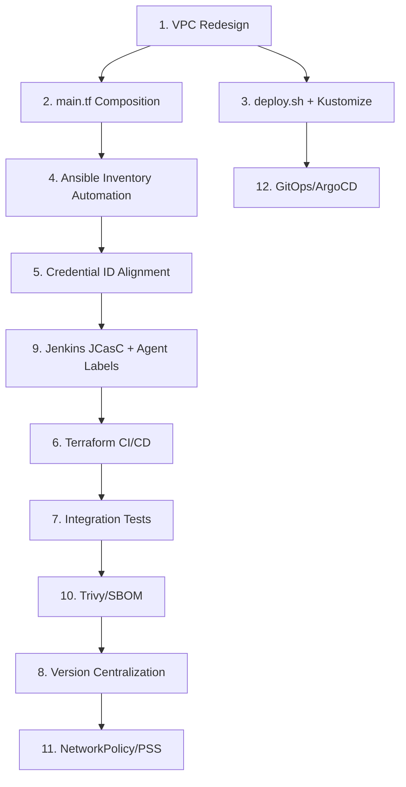

# Enterprise CI/CD EKS Terraform - Remediation Prompt

## Context
This project is an enterprise-grade CI/CD pipeline with Terraform, Ansible, Jenkins, Docker, SonarQube, and Kubernetes (EKS/Minikube). The code review identified **critical infrastructure issues** that must be fixed before production use.

---

## Primary Objective
Fix all **Critical (🔴)** and **High (🟠)** severity issues to make the infrastructure production-ready.

---

## Required Changes

### 1. 🔴 CRITICAL: Redesign VPC for Private EKS Nodes
**Files**: `terraform/vpc.tf`, `terraform/eks.tf`, `terraform/variables.tf`

**Requirements**:
- Add **private subnets** (2 AZs) for EKS worker nodes
- Add **NAT Gateway** (1 per AZ for HA) in public subnets
- Add **private route tables** with routes to NAT Gateways
- Update `eks.tf` to use `aws_subnet.private[*].id` for node groups
- Keep public subnets only for ALB/ingress controllers, bastion, or NAT
- Add variables for `enable_nat_gateway`, `single_nat_gateway` (cost optimization)

**Validation**: `terraform plan` shows nodes in private subnets, no public IPs on worker nodes.

---

### 2. 🔴 CRITICAL: Add Root Module Composition (`main.tf`)
**Files**: `terraform/main.tf` (new), `terraform/outputs.tf`

**Requirements**:
- Create `main.tf` that composes all modules in correct dependency order
- Call: `vpc` → `security_groups` → `eks` → `ec2` (Jenkins/SonarQube instances)
- Output all values needed by Ansible (instance IPs, DNS, EKS cluster name, SG IDs)
- Remove any circular dependencies
- Ensure `terraform apply` works from empty state

---

### 3. 🟠 HIGH: Fix `deploy.sh` — Stop Mutating Git-Tracked Files
**Files**: `deploy.sh`, `k8s/deployment.yaml`, `k8s/kustomization.yaml` (new)

**Requirements**:
- Replace `sed`/`envsubst` + file overwrite with **kustomize** overlay pattern
- Create `k8s/base/` with original manifests
- Create `k8s/overlays/dev/`, `k8s/overlays/prod/` with `kustomization.yaml` using `images:` transformer
- Update `deploy.sh` to: `kubectl apply -k k8s/overlays/${ENV:-dev}`
- Never write to `k8s/base/` or checked-in files
- Support `IMAGE_TAG` via kustomize `newTag:` or `images:` field

---

### 4. 🟠 HIGH: Automate Ansible Inventory from Terraform Outputs
**Files**: `ansible/inventory.ini` → `ansible/inventory.tpl` (template), `terraform/outputs.tf`, `scripts/generate_inventory.sh` (new)

**Requirements**:
- Terraform outputs: `jenkins_master_public_ip`, `jenkins_agent_public_ip`, `sonarqube_public_ip`, `eks_cluster_name`, `eks_cluster_endpoint`
- Create `generate_inventory.sh` that reads TF outputs (JSON) → renders `inventory.ini` via `envsubst` or template
- Document usage: `cd terraform && terraform output -json | ../scripts/generate_inventory.sh > ../ansible/inventory.ini`
- Remove manual IP copy-paste from SETUP.md

---

### 5. 🟠 HIGH: Align Credential IDs Across All Configurations
**Files**: `Jenkinsfile`, `README.md`, `SETUP.md`, `ansible/playbooks/*.yml`

**Requirements**:
- Standardize on **one** credential ID per secret type:
  - DockerHub: `dockerhub-credentials` (username/password)
  - SonarQube: `sonarqube-token` (secret text)
  - JFrog/Artifactory: `jfrog-artifactory-credentials` (if used)
- Update `Jenkinsfile`: `docker.withRegistry(..., 'dockerhub-credentials')`, `withSonarQubeEnv('sonarqube-token')`
- Update README/SETUP.md credential creation steps to match
- Update Ansible playbooks to configure Jenkins credentials with these exact IDs

---

### 6. 🟠 HIGH: Add Terraform CI/CD Pipeline
**Files**: `.github/workflows/terraform.yml` (new), `Jenkinsfile` (add terraform stage) or separate pipeline

**Requirements**:
- GitHub Actions or Jenkins pipeline for Terraform:
  - `terraform fmt -check`
  - `terraform validate`
  - `terraform plan` (on PR, comment results)
  - `terraform apply` (on merge to main, with manual approval)
- Use OIDC for AWS auth (no static keys in CI)
- Store plan artifact for apply stage
- Run in isolated workspace per PR

---

### 7. 🟠 HIGH: Add Real Tests (Beyond `contextLoads`)
**Files**: `app/src/test/java/com/razwan/`, `pom.xml`

**Requirements**:
- Add **Testcontainers** dependency for integration tests
- Write at least:
  - `AppIntegrationTest.java` — starts Spring context, tests `/actuator/health`, `/` endpoint
  - `AppContractTest.java` — if API contracts exist
- Configure `maven-failsafe-plugin` for integration tests (separate from surefire)
- Add `integration-test` profile in `pom.xml`
- Update Jenkinsfile: `stage('Integration Tests') { sh 'cd app && mvn verify -Pintegration-test' }`

---

### 8. 🟡 MEDIUM: Centralize Versions
**Files**: `terraform/versions.tf`, `app/pom.xml`, `Dockerfile`, `k8s/overlays/*/kustomization.yaml`, `Jenkinsfile`

**Requirements**:
- Create `versions.properties` (or `.tfvars` + `pom.xml` properties) as single source of truth:
  - Java version, Spring Boot version, Kubernetes version, EKS version, instance types
- Reference via:
  - Terraform: `var.java_version`, `var.kubernetes_version`
  - Maven: `<java.version>${java.version}</java.version>`
  - Dockerfile: `ARG JAVA_VERSION=17` → `FROM maven:${MAVEN_VERSION}-amazoncorretto-${JAVA_VERSION}`
  - Kustomize: `newTag: ${APP_VERSION}`
- Update all files to use variables, not hardcoded literals

---

### 9. 🟡 MEDIUM: Harden Jenkins Configuration
**Files**: `Jenkinsfile`, `ansible/playbooks/install_jenkins.yml`, `jenkins/casc.yaml` (new)

**Requirements**:
- Replace `agent any` with `agent { label 'maven' }`
- Add Jenkins Configuration as Code (JCasC) YAML for:
  - Global tools (Maven, JDK, Docker, kubectl)
  - Credentials (from Ansible vault or secrets manager)
  - SonarQube server configuration
  - Kubernetes cloud / agent templates
- Store `casc.yaml` in repo, mount via Ansible
- Add `options { timestamps(); timeout(time: 30, unit: 'MINUTES'); buildDiscarder(logRotator(numToKeepStr: '20')) }` to Jenkinsfile

---

### 10. 🟡 MEDIUM: Add Container Image Security Scanning
**Files**: `Jenkinsfile`, `Dockerfile`

**Requirements**:
- Add Trivy scan stage in Jenkinsfile **before** Docker Push:
  ```groovy
  stage('Security Scan') {
      steps {
          sh 'trivy image --exit-code 1 --severity HIGH,CRITICAL ${DOCKER_IMAGE}'
      }
  }
  ```
- Add Syft SBOM generation: `syft ${DOCKER_IMAGE} -o spdx-json > sbom.spdx.json`
- Archive SBOM as build artifact
- (Optional) Add cosign signing if keyless workflow configured

---

### 11. 🟡 MEDIUM: Add NetworkPolicy & PodSecurityStandards
**Files**: `k8s/base/networkpolicy.yaml` (new), `k8s/base/podsecurity.yaml` (new)

**Requirements**:
- `NetworkPolicy`: Default deny ingress/egress; allow only:
  - Ingress from LoadBalancer service to app pods on 8080
  - Egress to kube-dns (53), API server (443), DockerHub (443) for pulls
- `PodSecurityPolicy` or `PodSecurity` admission (restricted profile):
  - `runAsNonRoot: true`, `runAsUser: 1000`, `fsGroup: 1000`
  - `readOnlyRootFilesystem: true`
  - `allowPrivilegeEscalation: false`
  - Drop `ALL` capabilities

---

### 12. 🟡 MEDIUM: Implement GitOps with ArgoCD (or Flux)
**Files**: `argocd/` (new), `k8s/overlays/` (restructure)

**Requirements**:
- Install ArgoCD via Terraform (Helm release) or separate bootstrap
- Create `Application` manifests pointing to `k8s/overlays/prod`
- Enable auto-sync + prune + self-heal
- Remove manual `deploy.sh` from Jenkinsfile; Jenkins only builds/pushes image + updates kustomize `newTag` in Git (via GitOps PR)
- Document: "Jenkins builds, ArgoCD deploys"

---

## Acceptance Criteria

| # | Criterion | Verification |
|---|-----------|--------------|
| 1 | EKS nodes have **no public IPs** | `aws ec2 describe-instances --filters Name=tag:Name,Values=*node* --query 'Reservations[*].Instances[*].PublicIpAddress'` → empty |
| 2 | `terraform apply` works from clean state | `rm -rf .terraform && terraform init && terraform apply -auto-approve` succeeds |
| 3 | `deploy.sh` never modifies `k8s/base/` | `git status k8s/` clean after `./deploy.sh` |
| 4 | Ansible inventory generated automatically | `./scripts/generate_inventory.sh` produces valid `inventory.ini` with IPs |
| 5 | Jenkins pipeline uses correct credential IDs | Pipeline runs without "credentials not found" errors |
| 6 | Terraform changes validated in CI | PR shows plan comment; merge triggers apply with approval |
| 7 | Integration tests run in pipeline | `mvn verify -Pintegration-test` passes in Jenkins |
| 8 | All versions defined in one place | `grep -r "17\|3.3.5\|1.29" --include="*.tf" --include="*.xml" --include="*.yaml" --include="*.groovy" \| wc -l` → 0 (only in versions file) |
| 9 | Jenkins uses labeled agents | `agent { label 'maven' }` in Jenkinsfile; agent connects successfully |
| 10 | Trivy scan blocks critical vulns | Pipeline fails on `CRITICAL` CVE in base image |
| 11 | NetworkPolicy applied | `kubectl get networkpolicy -n advanced-cicd` shows policies; pods cannot curl external without allow |
| 12 | ArgoCD syncs deployment | `argocd app get advanced-cicd-app` shows Synced + Healthy |

---

## Execution Order (Dependencies)



---

## Deliverables

1. **Modified files** per requirements above
2. **New files**: `main.tf`, `k8s/base/`, `k8s/overlays/`, `scripts/generate_inventory.sh`, `versions.properties`, `jenkins/casc.yaml`, `.github/workflows/terraform.yml`, `argocd/`
3. **Updated documentation**: `README.md`, `SETUP.md` reflecting new workflows
4. **Verification script**: `scripts/verify_fixes.sh` that runs all acceptance criteria checks

---

## Constraints

- **No in-memory workarounds** — all changes must be persistent in Git
- **No bypassing actor system** — use proper Terraform/Ansible/Jenkins/K8s patterns
- **No "temporary" solutions** — each fix must be production-grade
- **All comments/docs in English**
- **Preserve existing functionality** — pipeline must still build, test, scan, deploy
- **Backward compatible** — existing `terraform.tfvars.example` should still work

---

## Success Definition

> "A junior DevOps engineer can clone this repo, run `terraform apply`, `./scripts/generate_inventory.sh`, `ansible-playbook -i inventory.ini playbooks/site.yml`, configure Jenkins with JCasC, push code, and have a **secure, private, GitOps-deployed** application running on EKS — with zero manual IP copy-paste, zero git-tracked file mutations, and zero hardcoded secrets."